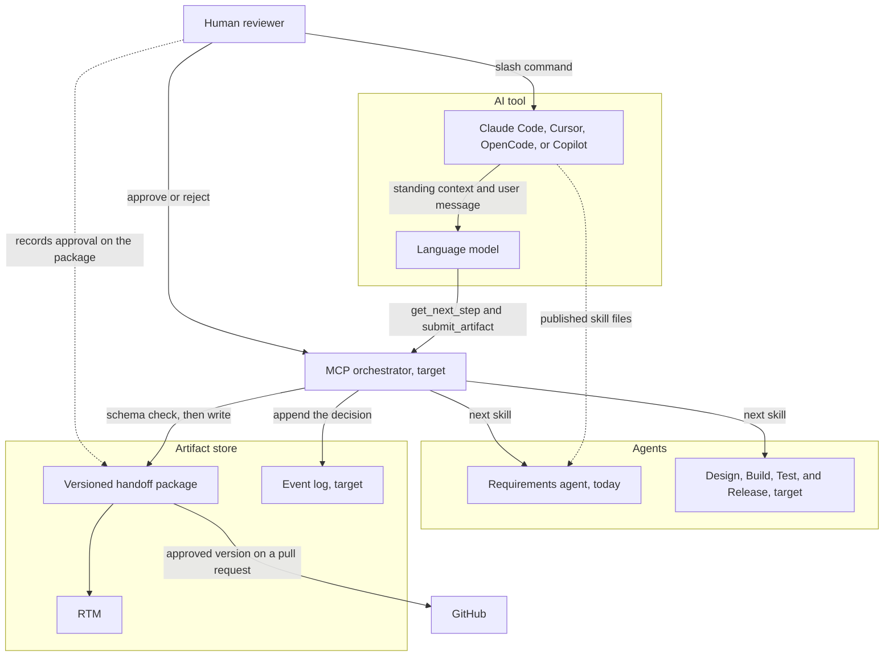
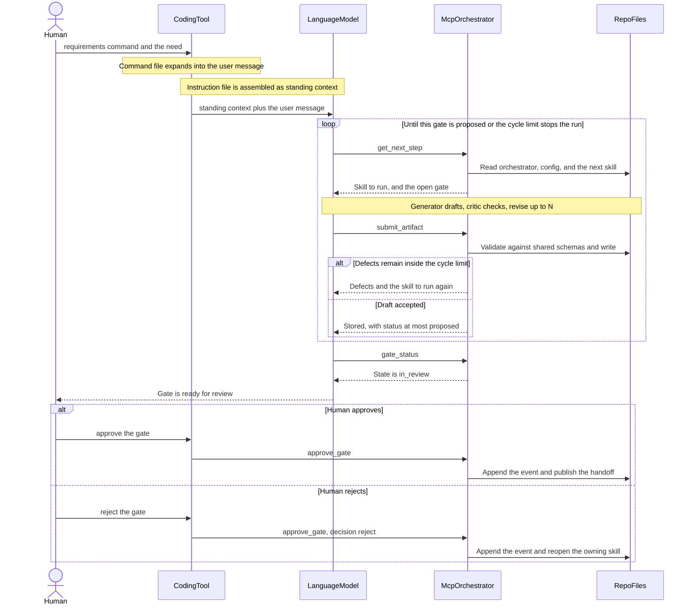
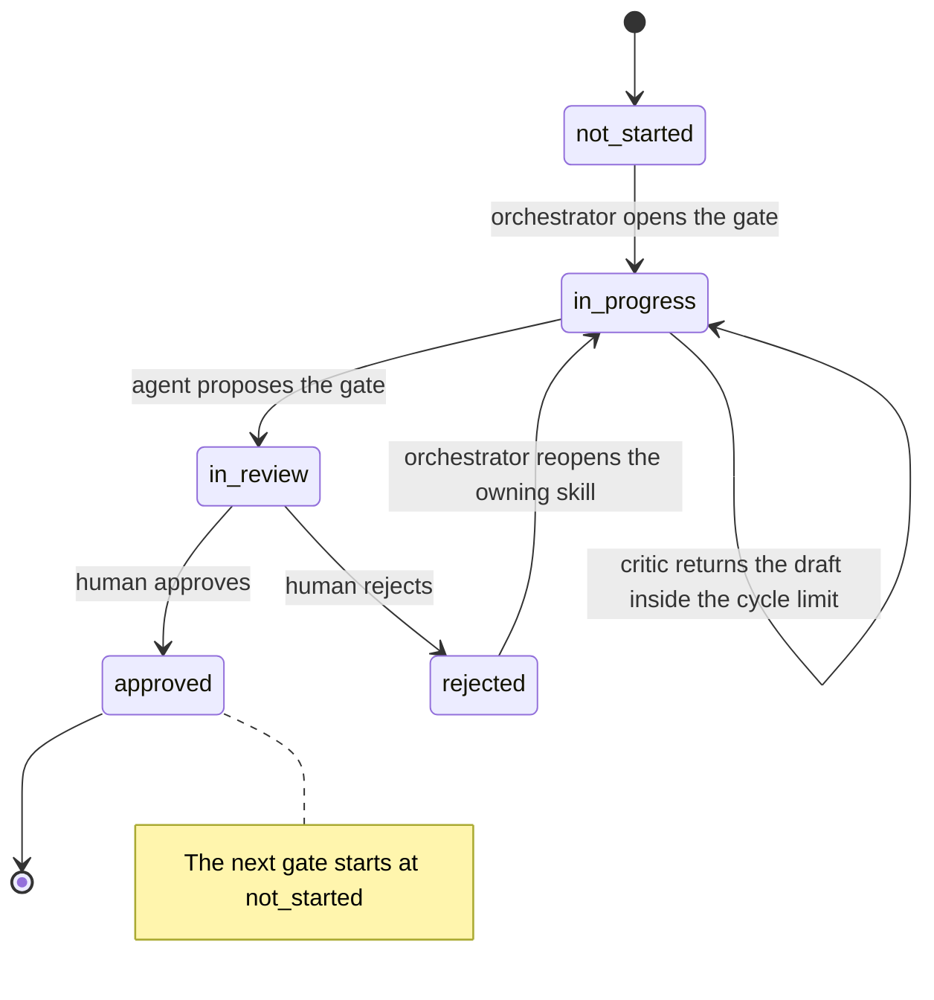
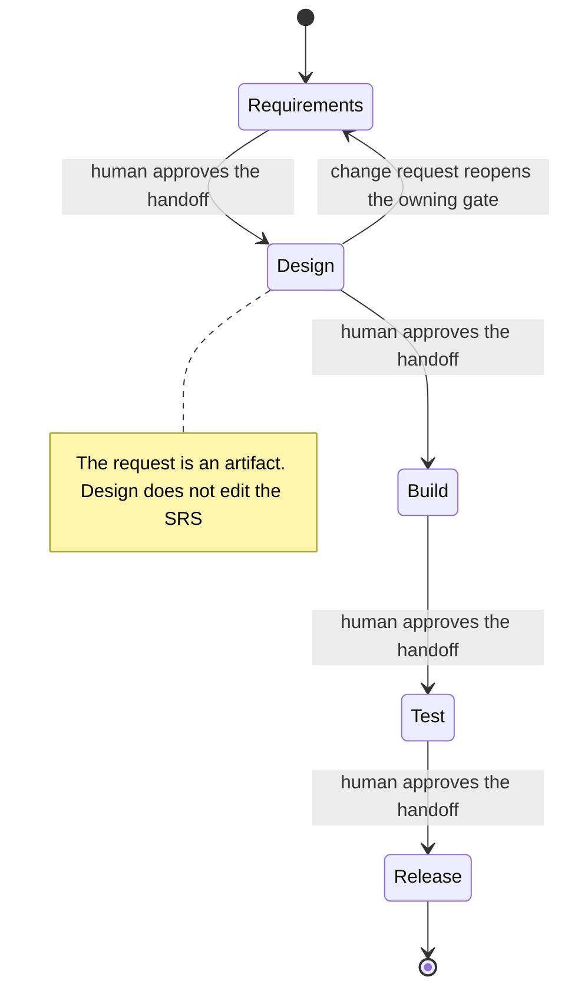
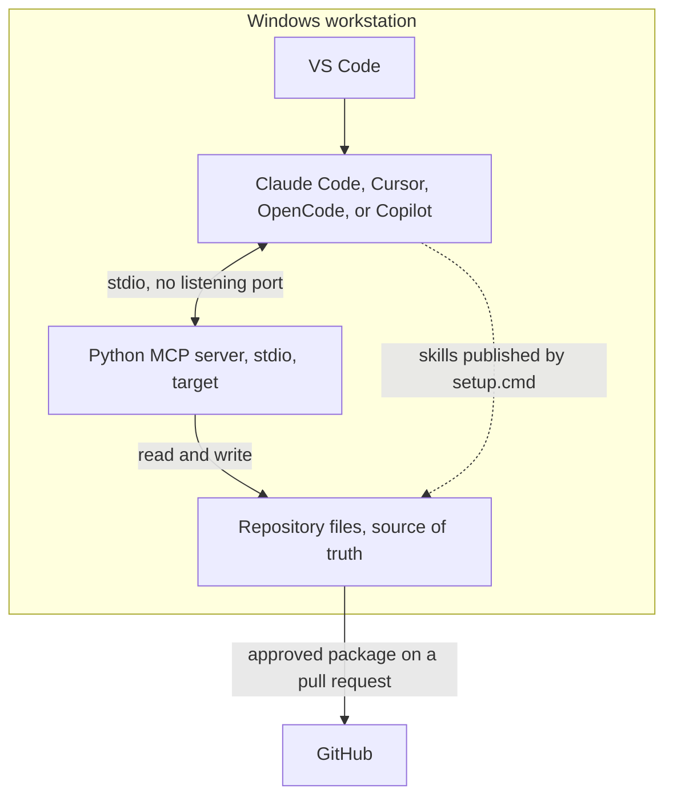

# Architecture

DevWorkbench is a tool-neutral workbench for AI-driven development across the software lifecycle. The procedure lives in this repository as Markdown, schemas, and templates. A coding tool supplies the model. The first agent, requirements, is the only agent implemented today.

Two words mark status throughout this document:

- **Today** means the file is in the repository and the requirements agent is written to follow it.
- **Target** means an agreed decision. That component is not in the repository yet, and nothing runs it.

Normative detail that already exists stays in the linked documents. This page is the map.

| Piece | Today | Target |
| --- | --- | --- |
| Requirements agent (`agents/requirements/`, skills 01–10) | Implemented | Unchanged procedure, served by the orchestrator |
| Design, build, test, release agents | Named in the roadmap only | One agent per phase |
| Phase machine | Roadmap order in the README | Enforced states: Requirements, Design, Build, Test, Release |
| Gate machine | The model writes `pass`, `fail`, or G5 `ready` and continues | `not_started`, `in_progress`, `in_review`, `approved`, `rejected` |
| Generator and critic | Skill 08 critiques the G2 draft, at most 3 cycles | A critic after each drafting step, same cycle limit, then skill 08 |
| Human decision | A person records package `approved` or `handed-off` | Only a person moves a gate or a phase; the agent stops at `proposed` |
| Handoff | Files under the engagement directory | Versioned, schema-checked packages in a shared store |
| Agent collaboration | One agent, so no calls exist; the rule is already "files, not chat" | No agent-to-agent calls; change requests go through the orchestrator |
| RTM | `rtm.csv` from need to requirement; design and test cells empty | Same matrix extended through design, code, and test |
| Event log | Not in the repo | Append-only audit log |
| MCP orchestrator | Not in the repo | Python, official `mcp` package, stdio, no listening port |
| Tool setup | `setup.cmd` / `setup.sh` publish skills into the tool | Stays as the fallback when MCP is not configured |
| GitHub | Five requirements milestones and ten skill issues exist | Pull requests carry the approved package version |

## Goals and principles

The workbench carries a stated need from requirements through release with an audit trail a later agent can check. The same procedure runs in Claude Code, Cursor, OpenCode, and, through `AGENTS.md`, GitHub Copilot.

- One phase has one owning agent. The owner is the only agent that may change that phase's baselined statements.
- The procedure is Markdown plus JSON Schema. Replacing the coding tool or the model does not replace the skills.
- A sentence that can be read as a fact needs a citation in the preserved source. Otherwise the agent omits it, records an exclusion the source stated, or appends an open question.
- The agent sets status only as far as `proposed`. A person approves or rejects. That decision is the only transition that moves a gate or a phase.
- Agents collaborate by writing versioned artifacts. They do not call each other. A downstream objection is a change request the orchestrator routes back to the owning agent.
- Identifiers freeze at requirements G4 and are never reused. A behavior change is a new id, a new validation, and a new human approval.
- Repository files are the source of truth. A session index is a cache of those files.
- The supported workstation is Windows and may not have PowerShell. Setup and the future server process go through `setup.cmd` and `py -3` (falling back to `python`).

The requirements quality bar is ISO/IEC/IEEE 29148:2018 (SRS outline clause 9.6, requirement characteristics clause 5.2, modal verb **shall**), ISO/IEC 25010:2023 (nine product-quality characteristics), MoSCoW as an attribute, and Gherkin acceptance criteria. The critic checklist is [agents/requirements/skills/08-validation/checklist.md](../agents/requirements/skills/08-validation/checklist.md).

## Context

The picture is the target runtime. Dotted edges are the path that actually runs today: the tool reads the published skill files, and a person records approval on the package itself. The MCP server, the later agents, and the event log are not in the repository. GitHub already has the requirements milestones and skill issues described below.



### Responsibilities

| Component | Accountability |
| --- | --- |
| Human reviewer | Answers open questions by adding a source note. Approves or rejects a gate or a phase. The agent cannot take this step. |
| Coding tool | Turns `/<agent>` into the user message, loads the generated instruction file as standing context, calls the model, and, on the target path, spawns the MCP server. The tool does not decide gates. |
| Language model | Follows the skill it was given, drafts, and revises from critic defects. Stops at `proposed`. |
| MCP orchestrator (target) | Owns the phase machine and the gate machine. Serves the next legal skill, validates artifacts, refuses illegal writes, persists a session index, and appends the event log. |
| Requirements agent (today) | Runs skills 01–10 and writes a proposed SRS package. Does not design, implement, test, or approve. |
| Later agents (target) | Each owns one phase, reads the previous handoff, writes only its own columns, and raises change requests instead of editing another phase's files. |
| Artifact store | The engagement files in the repo. Schemas in `shared/schemas/` are the machine contract. Markdown is the human copy of the same identifiers and shall strings. |
| RTM | One row per requirement. Today it traces need, requirement, scenario, and acceptance criterion. Design Element ID and Test Case ID are present and empty. |
| Event log (target) | Append-only record of proposals, approvals, rejections, and change requests. |
| GitHub | Mirror of the gates and skills. Milestones and skill issues for requirements exist today. |

## How a requirements run works

### Today

`scripts/setup.py`, started from [setup.cmd](../setup.cmd) or [setup.sh](../setup.sh), discovers every `agents/<id>/` that has an orchestrator and skills. It writes three things from [shared/tool-adapters/](../shared/tool-adapters/):

- Standing context, from `instructions.md.tmpl`, to `CLAUDE.md` (Claude Code) or `AGENTS.md` (Cursor, OpenCode, and Copilot).
- A slash command, from `command.md.tmpl`, to `.<tool>/commands/requirements.md`. The command name is the agent directory name.
- Skill files, copied on Windows and symlinked elsewhere, to `.<tool>/skills/<skill-name>/`. The folder name matches the frontmatter `name`, for example `requirements-01-intake`.

A person opens the repo in VS Code and runs `/requirements` plus the need. Where the tool expands `$ARGUMENTS`, that expansion is the need. Otherwise the need is the rest of the user message. The command tells the model to read [agents/requirements/agent/orchestrator.md](../agents/requirements/agent/orchestrator.md) and [agents/requirements/agent/config.yaml](../agents/requirements/agent/config.yaml), then the skill files in order.

The model is the scheduler. It copies the source byte for byte under `source/`, writes `working/` products, writes `working/gate-<id>.json` with `pass`, `fail`, or G5 `ready`, and stops at a failed gate. Skill 08 is the critic. Skill 10 sets `meta.status` to `proposed` and `approval.humanApproval.recorded` to false. There is no process that can stop a model which ignores the orchestrator.

`python3 agents/requirements/tests/eval-cases/check_handoff.py` validates the sample package against the schemas. It does not call a model. `scripts/check_setup.py` checks publishing. Neither script enforces gates on a live engagement.

### Target sequence

On the MCP path the tool still builds the prompt the same way. `get_next_step` returns the one skill the open gate allows, and `submit_artifact` is the write path. The fallback path above stays available when the server is not configured.



Prompt assembly (the command file and the instruction file) exists today. Every `MCP` message in the diagram is target.

### Generator and critic

Drafting skills write. A critic reads the draft against the checklist and returns defects. The generator revises. After N failed cycles the run stops, the remaining blocker and major defects go to `open-questions.md`, and the gate is not proposed.

N today is `limits.maxValidationCycles` in `config.yaml`, which is 3. The target uses that same number for each critic loop until a separate limit is added.

| Step | Today | Target |
| --- | --- | --- |
| Skills 01–03 | Write intake, stakeholders, and scope. Shall statements wait until G2. Each skill has its own checklist. | Same. They stay intake skills. |
| Skills 04–07 | Draft functional shalls, scenarios, 25010 coverage, and logical data. Defects wait for skill 08. | Generator, then a critic on the objects that step just wrote. |
| Skill 08 | The critic for the whole G2 draft. Checklist CHK-01–CHK-35. Blockers return to skill 01. Majors return to the owning G2 skill. | Stays the G3 critic for the full set, after the per-step critics. |
| Skill 09 | Builds the RTM and freezes ids. | Same, and only after G3 is approved. |
| Skill 10 | Assembles the package. It does not draft or approve. | Same. |

The critic checks 29148 clause 5.2 (one shall, unambiguous, testable, traceable, and the rest of the characteristics), the ambiguity and verb-law rows, Gherkin shape, and a coverage row for each of the nine 25010 characteristics. A repair that adds a fact the source does not contain fails the critic.

## Gate state machine

Target, for every gate of every agent. The requirements gates are the instance that exists today.



The agent may move a gate as far as `in_review`, which is the gate form of package status `proposed`. `approve_gate` is the human transition into `approved` or `rejected`. When the cycle limit is exhausted, the gate stays `in_progress` and the run stops with the defects in the open questions. A rejected gate names the skill to reopen. The default map is the one already in the orchestrator: a missing fact, a contradiction, or a suspected invention returns to skill 01; a wording or structure defect returns to skill 04, 05, 06, or 07.

Approving a gate opens the next one at `not_started`. Approving the last gate of a phase allows the phase transition. The server refuses a `submit_artifact` that sets `meta.status` or `approval.status` to `approved` or `handed-off`.

Today's gate file is evidence, not this state machine. The model writes it and is trusted to honor it.

| Target state | Who sets it | Closest record today |
| --- | --- | --- |
| `not_started` | Orchestrator | No `working/gate-<id>.json`, or `approval.gates[].result` of `not-run` |
| `in_progress` | Orchestrator | Skills running, `meta.status` `draft`, or a checklist fail that loops |
| `in_review` | Agent | G5 `ready` with `meta.status` `proposed`. G1–G4 `pass` is not a human review today; the model continues |
| `approved` | Human | `meta.status` `approved` |
| `rejected` | Human | No gate value. A human sending the work back is a new source note and a re-run |

`handed-off` stays a package status from [docs/agent-handoff.md](agent-handoff.md). It means the approved baseline has been published as the next phase's input. The agent does not set it. On the target path, publishing is the orchestrator's write after the human approves the last gate.

### Requirements gates

Entry and exit criteria are in [docs/sdlc-gates.md](sdlc-gates.md). The skill binding is `gates` in [config.yaml](../agents/requirements/agent/config.yaml).

| Gate | Name | Skills |
| --- | --- | --- |
| G1 | Intake and Scope | 01 intake, 02 stakeholders, 03 scope and context |
| G2 | Requirements Elicited | 04 functional requirements, 05 use cases and stories, 06 non-functional requirements, 07 data and interfaces |
| G3 | Requirements Validated | 08 validation |
| G4 | Traceability Baselined | 09 traceability |
| G5 | SRS Approved and Handed Off | 10 SRS assembly |

G5's name is the milestone outcome. The agent's own exit is a proposed package and `ready`. The milestone is reached when a person approves.

## Phase state machine

Target. The README also names Operate. In this machine an operational gap is a new requirements intake, not a sixth phase. See [Open questions](#open-questions).



A phase transition consumes a package in status `approved` or `handed-off`. That rule is already the handoff contract. `proposed` stays on the requirements side of the boundary until a person approves it.

Roadmap intent for the phases that have no skills yet is in [docs/sdlc-gates.md](sdlc-gates.md) under "Roadmap gates". Design allocates every requirement and fills Design Element ID inside the business data the SRS allows. Build implements only traced behavior and fills the code column. Test writes a result for each Gherkin criterion and fills Test Case ID. Release ships the Must set and still lists open questions. None of those agents exist.

### Change requests

A downstream agent that disagrees with a frozen shall does not edit `srs.json` and does not call the requirements agent. It submits a change request. The orchestrator routes it to the owning agent and reopens the named gate. The diagram shows the loop the next phase has to prove: Design back to Requirements. Build and Test use the same route when they exist.

The request cites the package version, the requirement ids, the conflict, and the gate and skill to reopen. It does not contain a replacement shall. The requirements agent files any new source note under `source/` as a new file, leaves the original untouched, and runs from the earliest skill the answer touches. Identifiers stay frozen: a replacement statement gets a new id, and the old id becomes `deferred` or `rejected`. A person approves the new baseline. The event log records the request, the reopen, and the approval.

Today this loop is a written rule in [docs/agent-handoff.md](agent-handoff.md) ("Change after baseline"). There is no change-request schema and no second agent to raise one.

## Data contracts

### Handoff package

An engagement is a directory. The sample is [agents/requirements/examples/output-sample/](../agents/requirements/examples/output-sample/) at `meta.version` `0.1.0` and `meta.status` `proposed`. `srs.json` there is a shape example, not an approved specification.

```text
agents/requirements/output/<engagement-id>/
  source/                         untouched request, plus later source notes
  working/                        one Markdown and one JSON fragment per skill
    gate-G1.json                  through gate-G5.json
  srs.md                          ISO/IEC/IEEE 29148:2018 clause 9.6
  srs.json                        shared/schemas/srs.schema.json
  rtm.csv                         columns from shared/templates/rtm.csv
  glossary.md
  open-questions.md
```

The five files at the engagement root are the handoff. `working/` is the audit trail. If Markdown and JSON disagree, the package is not ready. Skill 10 copies shall text from the working JSON and does not retype it.

`output/` is tracked only as an empty placeholder (`output/.gitkeep`). Generated engagements are local working files by convention. Git does not ignore them.

`srs.schema.json` (JSON Schema draft 2020-12) requires `meta`, `introduction`, `references`, `stakeholders`, `needs`, `scope`, `requirements`, `useCases`, `userStories`, `interfaces`, `dataEntities`, `glossary`, `openQuestions`, `qualityModelCoverage` (exactly nine rows), `traceability`, and `approval`. Each requirement object matches `requirement.schema.json`: one shall, a MoSCoW priority, a cited rationale, at least one need id and citation, a 29148 verification method, and at least one Gherkin criterion. Non-functional requirements name a 25010 characteristic. `meta.schemaVersion` is `1.0.0`. `meta.preparedBy` is `requirements-agent`.

A published handoff is that package at one version, for example SRS 1.2.0 together with the RTM of the same version. Consumers pin the version. A later cycle is a new version, not an edit of the published files.

### Status words

Package `meta.status` and requirement `status` are different enums.

| Package `meta.status` | Who may set it | Next phase may start |
| --- | --- | --- |
| `draft` | Agent | No |
| `proposed` | Agent | No |
| `approved` | Human | Design may start. Build waits for an approved design allocation |
| `handed-off` | Human, recorded when the package is published | Yes, under the handoff rules |

Requirement `status` is `draft`, `proposed`, `approved`, `deferred`, or `rejected`. Withdrawn ids stay in the package so they are not reused. Open-question `status` is `open`, `answered`, or `accepted-residual`. `accepted-residual` means a person accepted shipping without an answer. It is not an answer, and `residualRiskAccepted` is set only in that same human record.

### Identifiers

The grammar is normative in [docs/agent-handoff.md](agent-handoff.md). Prefixes include `NEED-###`, `STK-###`, `FR-###`, `NFR-###`, `AC-FR-###-##`, `AC-NFR-###-##`, `UC-###`, `US-###`, `IF-###`, `ENT-###`, `OQ-###`, `SC-IN-##`, `SC-OUT-##`, `CON-###`, `DEP-###`, `ASM-###`, and `POL-AAA-##`. Ids freeze at G4. Downstream artifacts cite them and do not invent a parallel numbering for the same obligation.

### RTM

Today's header, from [shared/templates/rtm.csv](../shared/templates/rtm.csv):

```text
Requirement ID, Type, Statement, Priority, Status, Source Need IDs, Citations,
Stakeholder IDs, Use Case IDs, User Story IDs, Acceptance Criteria IDs,
Verification Method, Quality Attribute, Design Element ID, Test Case ID
```

Empty consumer cells are empty strings. They are not `TBD`. The requirements agent leaves Design Element ID and Test Case ID empty. Design fills the first. Test fills the second. The target adds a code column between them, written only by the build agent, so a row reads requirement, then design, then code, then test. That column is not in the template yet. Its header and cell format are an open question.

### Event log and change request

Both are target. No schema file exists yet.

The event log is an append-only JSONL file beside the package, one object per line. A line records the time, the actor (agent id, or a named person), the engagement id, the package version, the gate or phase, the action (`proposed`, `approved`, `rejected`, `change-requested`), and the artifact paths. The server appends. It does not rewrite earlier lines. If a session index and the files disagree, the files win and the index is rebuilt.

A change request is a JSON artifact in the store, illustrative shape:

```json
{
  "id": "CR-001",
  "from": "design",
  "packageVersion": "1.2.0",
  "requirementIds": ["FR-014"],
  "conflict": "The allocation cannot satisfy the shall without a fact the SRS left open.",
  "reopenGate": "G1",
  "reopenSkill": "01"
}
```

### Who writes which fields

The full table is in [docs/agent-handoff.md](agent-handoff.md). The rule that matters for the orchestrator: after G4 the requirements agent is the only writer of shall text, priority, need ids, and acceptance criteria, and only on a new cycle. Design writes Design Element ID. Build writes the code column. Test writes Test Case ID. Nobody downstream closes an open question or adds a shall.

## Tools and deployment

Today the workstation install is a file copy. `setup.cmd` is a batch file. It runs `py -3` and, if the Python launcher is missing, `python`. It does not call PowerShell. The first Windows run copies skill files because symlinks need Developer Mode or an elevated prompt. `./setup.sh` is the same publisher for macOS, Linux, and Git Bash, and it symlinks when the filesystem allows. Targets are `claude`, `cursor`, `opencode`, and `all`. Generated files are gitignored. The source of truth remains `agents/<agent>/skills/`.

Copilot Chat in VS Code, the Copilot cloud agent, and Copilot CLI read the `AGENTS.md` produced by a `cursor`, `opencode`, or `all` setup. This repository does not add a Copilot slash command.



The target server is a local process the tool spawns. It uses the official Python `mcp` package, speaks stdio on stdin and stdout, and binds no port. It is not in the repository, and there is no Python dependency file yet. The tool's MCP client config points at `py -3` and the server script, the same interpreter `setup.cmd` already finds. The server reads and writes repository files. Session state is an index next to the engagement, rebuilt from those files at startup.

Target tools:

| Tool | Caller | Effect |
| --- | --- | --- |
| `get_next_step` | Model | Returns the skill the open gate allows, with its inputs. Refuses a skill in a later gate. |
| `submit_artifact` | Model | Validates the document against `shared/schemas/`, writes the file, and refuses a status above `proposed` or a column the agent does not own. |
| `gate_status` | Model or human | Returns the gate state, who proposed it, and the evidence paths. |
| `approve_gate` | Human | `approve` moves `in_review` to `approved` and opens the next gate. `reject` moves it to `rejected` and reopens the owning skill. Requires a named person. |

`approve_gate` is a human tool. The model's tools are `get_next_step`, `submit_artifact`, and `gate_status`. A `submit_artifact` that tries to record approval fails closed.

When the server is absent, the tool uses the published skill files and the current orchestrator. On that fallback the model still walks G1–G4 itself and asks a person only at the package, which is today's procedure. The stricter per-gate checkpoint is the MCP path, where `get_next_step` will not offer the next gate until `approve_gate`.

## GitHub

Today the repository `shaighub/DevWorkbench` has five open milestones and ten open skill issues:

| Milestone | Skill issues | Labels |
| --- | --- | --- |
| Requirements G1: Intake and Scope | Skills 01–03 | `gate:G1`, `agent:requirements` |
| Requirements G2: Requirements Elicited | Skills 04–07 | `gate:G2`, `agent:requirements` |
| Requirements G3: Requirements Validated | Skill 08 | `gate:G3`, `agent:requirements` |
| Requirements G4: Traceability Baselined | Skill 09 | `gate:G4`, `agent:requirements` |
| Requirements G5: SRS Approved and Handed Off | Skill 10 | `gate:G5`, `agent:requirements` |

Milestone titles and bodies are in [docs/sdlc-gates.md](sdlc-gates.md). No workflow in the repository creates or updates those objects.

Target: one milestone per gate and one issue per skill, including later phases. The pull request that records an approval carries the approved package version (the SRS and the RTM of that version, and the other package files). The event-log line and the pull request reference each other. A change-request cycle is a further pull request with a new package version, not a force-push of the approved one.

## Adding an agent

Today, `scripts/setup.py` has no agent list. Discovery is the directory. [docs/tool-setup.md](tool-setup.md) is the publisher's procedure. The steps are:

1. Create `agents/<id>/agent/orchestrator.md`. `<id>` is lowercase kebab-case and becomes the slash command.
2. Add `agents/<id>/agent/config.yaml`. `agent.id` matches the directory. `skills` lists each `skills/<nn-name>` directory. `limits.maxValidationCycles` is the critic budget. `paths` points at the schemas, templates, gate doc, and handoff doc.
3. Add `agents/<id>/skills/<nn-name>/SKILL.md` with `name: <id>-<nn-name>` and a `description`. The name is at most 64 characters. Sibling notes (checklists, templates) live in the same directory.
4. Add a schema under `shared/schemas/` when the phase produces a machine-readable package.
5. Document the gates and the columns this agent may write. Re-run setup. `check_setup.py` expects a new agent to be discovered without a code change.

Target, once the orchestrator exists, the same directory also registers the phase:

6. Add the phase to the phase machine, with the handoff package it consumes and the package it publishes.
7. Declare the gate ids, the skill that runs in each, and the defect map used when a human rejects.
8. Declare the RTM columns this agent may fill and the paths `submit_artifact` may write.
9. Declare the change requests it raises, and which owner gate each request reopens.
10. Add the milestone text and one issue per skill, with an `agent:<id>` label and a `gate:` label.

The new agent reads the previous package from the store. It does not import the previous agent's code, and it does not receive a tool that calls that agent.

## Roadmap

| Step | Delivers | What it proves |
| --- | --- | --- |
| 1 | The MCP orchestrator wrapped around the existing requirements agent. Skill files stay as they are. `setup.cmd` stays the fallback. | `get_next_step` refuses to skip a gate. `submit_artifact` validates and stops at `proposed`. `approve_gate` is the only way out of `in_review`. The session index rebuilds from the engagement files. |
| 2 | A design agent. | It consumes an approved SRS version, writes only Design Element ID and its own design artifact, and a change request reopens the requirements gate instead of editing the SRS. |
| 3+ | Build, then test, then release. | The RTM row grows a code id, then a test id and a Gherkin result. Release notes still list unanswered questions. Each phase is one agent, one milestone per gate, one issue per skill. |

Phase 1 does not change skill behavior on the fallback path. The per-step critic and the per-gate human checkpoint land in the server first. Skills 04–07 grow an explicit critic pass when that server is the path a run actually takes.

## Open questions

1. **Where an approved package is committed.** Working files live under `agents/requirements/output/<engagement-id>/`, which is an empty placeholder in git. The target pull request carries the approved version. The committed layout is undecided: the engagement directory at approval time, or a copy of the package files and the event log at a versioned path. `working/` remains the audit trail in either case.
2. **Operate.** The README and the roadmap gates name an Operate phase whose feedback re-enters intake. The agreed machine has five phases, and this document treats that feedback as a new requirements intake. Confirm that Operate is not its own agent.
3. **Code column.** Header name and cell format (id, repository path, or symbol) for the RTM column between Design Element ID and Test Case ID. Needed before the build agent.
4. **Which tools phase 1 registers as MCP clients.** Claude Code, Cursor, and OpenCode can spawn a stdio server. Copilot in this repo is `AGENTS.md` only. Undecided: which clients setup should write config for, and whether that config is generated.
5. **Who reads the event log.** It is the audit record. Undecided: whether a downstream agent is required to read it, or consumers keep trusting the package files alone, as they are told to ignore `working/` today.

## Related documents

- [docs/sdlc-gates.md](sdlc-gates.md) — entry and exit criteria, the requirements flow, roadmap gates, milestone text.
- [docs/agent-handoff.md](agent-handoff.md) — package rules, identifier grammar, status, and who may write which fields.
- [docs/tool-setup.md](tool-setup.md) — publisher, tool paths, adding an agent or an adapter.
- [agents/requirements/agent/orchestrator.md](../agents/requirements/agent/orchestrator.md) — the procedure the model follows today.
- [agents/requirements/agent/config.yaml](../agents/requirements/agent/config.yaml) — skill order, gate binding, paths, and the cycle limit.
