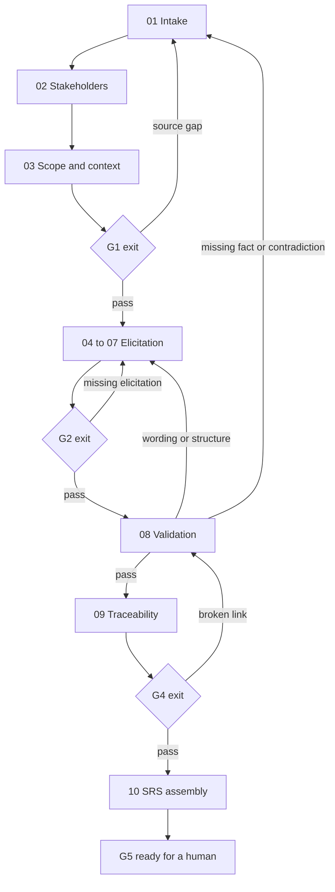

# SDLC gates

A gate is a decision to let work move forward. The requirements agent is the only agent in this workbench today. Later phases are named so the handoff has somewhere to land. Their skills do not exist yet. Do not treat the roadmap gates as procedures you can execute.

The requirements phase follows ISO/IEC/IEEE 29148:2018 for the specification and for what makes a requirement acceptable, ISO/IEC 25010:2023 for quality characteristics, MoSCoW for release priority, and Gherkin for acceptance criteria.

## How to read a gate

Entry is what must already be true. Exit is what this gate adds. Skills are the only procedures that may run while the gate is open. A gate fails closed: the agent does not start the next gate, and it does not fill the hole with a plausible fact.

Loopback from validation is mandatory. Skill 08 sends a missing fact or a contradiction back to intake (G1), not to a quiet edit. It sends a wording or structure defect back to the skill that owns the statement (G2). After three validation cycles the agent stops, leaves the blockers in `open-questions.md`, and does not assemble a proposed SRS.

## Requirements phase

These five gates are the requirements milestones. Skill files live under `agents/requirements/skills/`.

### Requirements G1: Intake and Scope

Skills: `01-intake`, `02-stakeholders`, `03-scope-context`.

Entry:

- A requester has supplied a high-level need in any durable form: a paragraph, a business request, a ticket, or a transcript.
- The text is preserved unchanged. Paraphrase does not replace it.

Exit, all of these:

- The problem and the outcome are written so the sponsor can recognize them, and every sentence cites the source.
- Needs are in stakeholder language, each with a citation. None of them is a shall statement.
- The stakeholder register contains every person and role the source names, including people named but not interviewed. Interest or influence that the source does not state is `unknown` or is labeled as an analyst judgment.
- In-scope items and explicit exclusions are listed and cited. Exclusions use MoSCoW Won't.
- The boundary rule is recorded: a topic the source does not mention is not a requirement.
- Terms that a shall statement would rely on are in the glossary, or they are open questions. Definitions are not imported from general knowledge.
- Every unknown that would change a later shall is an open question with a blocking flag. Nothing in the G1 package answers an open question.
- No functional or non-functional requirement has been written yet.

Failure: send the unanswered questions to the requester and stay in G1. Do not open G2 "with assumptions" to keep moving.

### Requirements G2: Requirements Elicited

Skills: `04-functional-reqs`, `05-use-cases-stories`, `06-nonfunctional-reqs`, `07-data-interfaces`.

Entry:

- G1 exit criteria are recorded in the engagement folder.
- No blocking open question from G1 is still unanswered. A blocking question is one without which a requested shall cannot be written unambiguously.

Exit, all of these:

- Every accepted need is either the source of at least one requirement, an explicit exclusion, or an open question that explains the gap.
- Each requirement has one shall, a MoSCoW priority with a rationale cited from the source, at least one need id, at least one citation, a rationale, a 29148 verification method, a status, and at least one Gherkin acceptance criterion.
- Priority was not guessed. Where the source does not say how firm the commitment is, the item is an open question and the requirement stays unwritten or in `draft`.
- Each non-functional requirement names an ISO/IEC 25010:2023 characteristic and subcharacteristic, and it states scale, meter, and target from the source. A missing number is an open question, not a filled-in industry default.
- All nine 25010 characteristics have a coverage row: covered, not applicable, open question, or not stated.
- Use-case steps and user stories cite requirement ids. A step or a story that adds behavior is a defect.
- Logical entities and external interfaces use only business facts already in the source or in a requirement. Wire formats the source did not specify are deferred to design in writing, not invented.
- No requirement restates an out-of-scope item or answers an open question.

Failure: stay in G2 and rerun the skill that lacks evidence.

### Requirements G3: Requirements Validated

Skill: `08-validation`.

Entry:

- A G2 draft exists: requirements, scenarios, stories, quality coverage, entities, and interfaces.

Exit, all of these:

- Every item in `skills/08-validation/checklist.md` is pass or not applicable, with evidence (an id or a quotation).
- Schema checks for the requirement objects pass.
- Every shall can be pointed at a quotation in the source. A shall that cannot is deleted, not repaired by invention.
- Contradictions are either removed by striking the unsupported side or recorded as blocking open questions. The agent does not pick the winner.
- No open question is hidden inside a shall by words such as "as appropriate", "if needed", or "TBD".
- Remaining unknowns are in `open-questions.md` with blocking flags.

Loop:

- Missing source, contradiction, or suspected invention → G1 (intake). Do not edit the shall to paper over the gap.
- Ambiguous, non-singular, or untestable wording, missing criterion, or broken 25010 row → the owning G2 skill.
- Three cycles without a pass → stop. Do not baseline.

### Requirements G4: Traceability Baselined

Skill: `09-traceability`.

Entry:

- G3 passed on this cycle. Checklist evidence is in the engagement folder.

Exit, all of these:

- `rtm.csv` has one row per requirement and the columns in `shared/templates/rtm.csv`, including Design Element ID and Test Case ID.
- Those two consumer columns are empty. Blank means the consumer has not worked yet. The cell is not the text `TBD`.
- Every need traces to a requirement, an exclusion, or an open question. Every requirement traces to a need that exists. Acceptance-criterion, use-case, and story ids all resolve.
- Identifiers are frozen. The freeze is recorded on the traceability object. Withdrawn ids will not be reused.
- Orphans and uncovered needs are empty. If they are not, G4 fails and the work returns to the skill that dropped the link.

### Requirements G5: SRS Approved and Handed Off

Skill: `10-srs-assembly`.

Entry:

- G4 passed and identifiers are frozen.
- No blocking open question remains open.

Exit, all of these:

- `srs.md` follows `shared/templates/srs-ieee29148.md` (29148 clause 9.6).
- `srs.json` validates against `shared/schemas/srs.schema.json`, and every requirement validates against `shared/schemas/requirement.schema.json`.
- The shall text, ids, and priorities in the Markdown and the JSON are the same strings.
- `glossary.md`, `open-questions.md`, and `rtm.csv` are present and match the JSON.
- Status is `proposed` and G5 is `ready`. Design, build, and test are named as consumers, with the rule that they do not answer open questions and do not add shall statements.
- A named human has not been signed by the agent. Status becomes `approved` or `handed-off` only when a human records that approval on the package. Downstream phases consume a package only in those two statuses.

Failure: do not call the package handed off. If a blocking question is still open, do not mark G5 ready.

## What "never guess" means at a gate

An unresolved point is written to `open-questions.md` with the skill that raised it, whether it is blocking, and the decision that must not be invented while it stays open. Acceptable dispositions are:

| Situation | What is written | What is not written |
| --- | --- | --- |
| The source states the rule | A shall with a citation | A second, looser copy of the same rule |
| The source states a number, a list, or a limit | That value in the shall or the criterion | A rounder or "safer" number |
| The source excludes a topic | An out-of-scope row, priority Won't | A shall that delivers it "just in case" |
| The source is silent | Nothing, or a non-blocking question if a later skill would be tempted to fill it | A shall, a default, or a typical control |
| The source contradicts itself | A blocking open question; both shalls withdrawn or returned to draft | A compromise sentence |
| Two readings are both defensible and the sponsor cannot be asked yet | An assumption with the ids to rewrite if it is false | A silent choice of one reading |
| The source defers representation to design | A constraint that design will choose the representation inside the stated business rules | A payload, schema, or protocol |

Assumptions are a last resort. An open question is preferred whenever the sponsor could answer.

## Roadmap gates (no skills yet)

These gates describe the contract later agents will be held to. They are not milestones and they have no skills mapped. Entry depends on a requirements package in status `approved` or `handed-off`.

| Phase | Gate intent | Entry | Exit | Skills |
| --- | --- | --- | --- | --- |
| Design | Allocate and specify | Handed-off SRS. Identifiers frozen. | Every requirement is allocated to a design element. Interface representation is specified only inside the business data the SRS allows. No open question is closed by a design choice. RTM design column filled. | None yet |
| Build | Implement against allocation | Design allocation approved. | Behavior that a requirement covers is traceable to that id. Behavior no requirement covers is not added. | None yet |
| Test | Verify acceptance criteria | SRS criteria plus a build. | Each Gherkin criterion has a test case id and a result. RTM test column filled. A failed criterion is a defect against the requirement, not an edit to the requirement. | None yet |
| Release | Ship a known baseline | Test evidence for every Must requirement that this release includes. | Open questions that are still open are listed in the release notes. None has been closed by silence. | None yet |
| Operate | Feed the next intake | A released system. | Observed gaps become a new requirements intake. They do not change behavior without a new or revised requirement id. | None yet |

## Milestone text

The GitHub milestones for the requirements phase, when created on `shaighub/DevWorkbench`, use the titles and bodies below. Skill issues map to the milestone of their gate.

### Milestone: Requirements G1: Intake and Scope

Entry: a high-level need is preserved unchanged. Exit: cited problem and needs, a stakeholder register, cited scope and exclusions, glossary or open questions for ambiguous terms, and no requirements written. Skills: 01 Intake, 02 Stakeholders, 03 Scope and context. Failure returns to the requester. Unknowns go to open questions. The agent does not guess.

### Milestone: Requirements G2: Requirements Elicited

Entry: G1 exit is recorded and no blocking question is unanswered. Exit: singular shall statements with MoSCoW, source needs, Gherkin, and verification; 25010 coverage for all nine characteristics; scenarios and stories that do not add behavior; logical data and interfaces without invented wire formats. Skills: 04 Functional requirements, 05 Use cases and stories, 06 Non-functional requirements, 07 Data and interfaces.

### Milestone: Requirements G3: Requirements Validated

Entry: the G2 draft. Exit: the validation checklist has no unresolved defect, every shall has a source quotation, and contradictions are open questions rather than silent choices. Skill: 08 Validation. Source gaps loop to G1. Wording defects loop to the owning G2 skill. After three cycles the agent stops without baselining.

### Milestone: Requirements G4: Traceability Baselined

Entry: G3 passed. Exit: one RTM row per requirement, needs and requirements covered in both directions, consumer columns present and empty, identifiers frozen. Skill: 09 Traceability.

### Milestone: Requirements G5: SRS Approved and Handed Off

Entry: G4 passed and no blocking question is open. Exit: `srs.md` in the 29148 outline, `srs.json` valid against the shared schemas, Markdown and JSON using the same shall text, status `proposed`, consumers named. Skill: 10 SRS assembly. A human records approval. The agent does not set `handed-off` itself.
